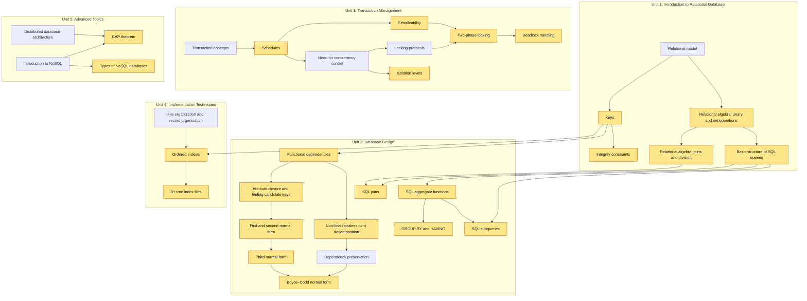

# 05 — DBMS Concept Map

Built from the **BE23CS405 Database Management System** syllabus (KIOT, Regulations 2023), the five unit notes, and the unit question banks. The prescribed textbooks (Silberschatz–Korth–Sudarshan; Elmasri–Navathe) are listed as references for deeper explanations.

Machine-readable versions, ready to load into the app:

- [`content/concept_graph.yaml`](../content/concept_graph.yaml): 63 concepts, 74 prerequisite edges (checked to be acyclic), Bloom level from the syllabus, question types, and a pointer to the section in your notes.
- [`content/misconceptions.yaml`](../content/misconceptions.yaml): 44 misconceptions across all five units, each linked to concepts, with a one-line remediation.

## At a glance

| Unit | Title | Concepts | Demo core |
|---|---|---|---|
| 1 | Introduction to Relational Database | 12 | 5 |
| 2 | Database Design | 19 | 10 |
| 3 | Transaction Management | 13 | 5 |
| 4 | Implementation Techniques | 9 | 2 |
| 5 | Advanced Topics | 10 | 2 |
| | **Total** | **63** | **24** |

**Demo core** marks the 24 concepts to seed with questions first in the 8-hour build. They cover all five units, so the teacher heatmap shows the whole course, and they lean on Unit 2 (SQL and normalization) because those answers can be checked by running code.

**Question types per concept:** `sql` = checked by running on the sample DB · `fd` = checked by the closure / candidate-key code · `schedule` = checked by precedence-graph or lock-simulation code · `mcq` = LLM cross-check. Units 4 and 5 are mostly theory (syllabus level L2), so they're MCQ-only, which fits the question banks.

## Demo-core graph

Yellow = demo core. Arrows go from a prerequisite to the concept that depends on it. Cross-unit links: keys feed FDs and indexing; relational algebra feeds SQL and query processing; DML feeds transactions; DCL feeds access control.

## Concepts by unit

### Unit 1 — Introduction to Relational Database

| Concept | Bloom | Prerequisites | Types | Misconceptions |
|---|---|---|---|---|
| Purpose of database systems | L2 | — | mcq | — |
| Views of data and data abstraction | L2 | Purpose of database systems | mcq | MC-ARCH-01 |
| Data models | L2 | Views of data and data abstraction | mcq | — |
| Database system architecture | L2 | Views of data and data abstraction | mcq | — |
| Relational model | L2 | Data models | mcq | — |
| **Keys** ★ | L3 | Relational model | mcq, fd | MC-KEY-01, MC-KEY-02 |
| **Integrity constraints** ★ | L2 | Keys | mcq, sql | MC-KEY-03 |
| **Relational algebra: unary and set operations** ★ | L3 | Relational model | mcq, sql | MC-RA-01 |
| **Relational algebra: joins and division** ★ | L3 | Relational algebra: unary and set operations | mcq, sql | MC-RA-02, MC-JOIN-02 |
| **Basic structure of SQL queries** ★ | L3 | Relational algebra: unary and set operations | sql, mcq | MC-NULL-01 |
| SQL DDL | L3 | Integrity constraints | mcq, sql | MC-SQL-01 |
| SQL DML | L3 | SQL DDL, Basic structure of SQL queries | mcq, sql | MC-SQL-01 |

### Unit 2 — Database Design

| Concept | Bloom | Prerequisites | Types | Misconceptions |
|---|---|---|---|---|
| Entity–relationship model | L2 | Relational model | mcq | — |
| E-R diagrams | L3 | Entity–relationship model | mcq | MC-ER-01 |
| ER-to-relational mapping | L3 | E-R diagrams, Keys | mcq | MC-ER-01, MC-ER-02 |
| **Functional dependencies** ★ | L3 | Keys | mcq, fd | MC-FD-01, MC-FD-02 |
| **Attribute closure and finding candidate keys** ★ | L3 | Functional dependencies | fd | MC-KEY-01, MC-KEY-02 |
| **Non-loss (lossless-join) decomposition** ★ | L3 | Functional dependencies | mcq, fd | MC-DEC-01 |
| Dependency preservation | L3 | Non-loss (lossless-join) decomposition | mcq, fd | MC-NF-03 |
| **First and second normal form** ★ | L3 | Attribute closure and finding candidate keys | mcq, fd | MC-NF-02, MC-NF-04 |
| **Third normal form** ★ | L3 | First and second normal form | mcq, fd | MC-NF-01, MC-NF-02 |
| **Boyce–Codd normal form** ★ | L3 | Third normal form, Dependency preservation | mcq, fd | MC-NF-01, MC-NF-03 |
| Multivalued dependencies and 4NF | L3 | Boyce–Codd normal form | mcq | — |
| Join dependencies and 5NF | L3 | Multivalued dependencies and 4NF, Non-loss (lossless-join) decomposition | mcq | — |
| SQL set operations | L3 | Basic structure of SQL queries, Relational algebra: unary and set operations | sql, mcq | MC-SET-01 |
| **SQL aggregate functions** ★ | L3 | Basic structure of SQL queries | sql, mcq | MC-NULL-02 |
| **GROUP BY and HAVING** ★ | L3 | SQL aggregate functions | sql, mcq | MC-AGG-01, MC-AGG-02 |
| **SQL joins** ★ | L3 | Relational algebra: joins and division, Basic structure of SQL queries | sql, mcq | MC-RA-02, MC-JOIN-01, MC-JOIN-02 |
| **SQL subqueries** ★ | L3 | SQL aggregate functions, Basic structure of SQL queries | sql, mcq | MC-NULL-03 |
| SQL views | L3 | SQL joins | sql, mcq | MC-VIEW-01 |
| SQL triggers | L3 | SQL DML | mcq | — |

### Unit 3 — Transaction Management

| Concept | Bloom | Prerequisites | Types | Misconceptions |
|---|---|---|---|---|
| Transaction concepts | L2 | SQL DML | mcq | — |
| ACID properties | L2 | Transaction concepts | mcq | MC-TX-03 |
| **Schedules** ★ | L3 | Transaction concepts | mcq, schedule | MC-TX-04 |
| **Serializability** ★ | L3 | Schedules | mcq, schedule | MC-TX-02 |
| Need for concurrency control | L2 | Schedules | mcq | — |
| Locking protocols | L3 | Need for concurrency control | mcq | — |
| **Two-phase locking** ★ | L3 | Locking protocols, Serializability | mcq, schedule | MC-TX-01 |
| **Deadlock handling** ★ | L3 | Two-phase locking | mcq, schedule | MC-TX-01, MC-TX-05 |
| **Isolation levels** ★ | L2 | Need for concurrency control | mcq | MC-ISO-01 |
| SQL DCL and TCL commands | L3 | SQL DML, Transaction concepts | mcq | MC-TCL-01 |
| Savepoints | L2 | SQL DCL and TCL commands | mcq | MC-TCL-01 |
| Transaction recovery | L2 | ACID properties | mcq | — |
| Backup and recovery systems | L2 | Transaction recovery | mcq | — |

### Unit 4 — Implementation Techniques

| Concept | Bloom | Prerequisites | Types | Misconceptions |
|---|---|---|---|---|
| RAID | L2 | — | mcq | MC-RAID-01, MC-RAID-02 |
| File organization and record organization | L2 | — | mcq | — |
| **Ordered indices** ★ | L2 | File organization and record organization, Keys | mcq | MC-IDX-01, MC-IDX-02 |
| **B+ tree index files** ★ | L3 | Ordered indices | mcq | MC-IDX-03 |
| B tree index files | L3 | B+ tree index files | mcq | MC-IDX-03 |
| Static hashing | L2 | File organization and record organization | mcq | MC-HASH-01 |
| Dynamic (extendible) hashing | L2 | Static hashing | mcq | MC-HASH-01 |
| Query processing overview | L2 | Relational algebra: joins and division, Ordered indices | mcq | MC-QO-01 |
| Query optimization (heuristics and cost estimation) | L3 | Query processing overview | mcq | MC-IDX-01, MC-QO-01 |

### Unit 5 — Advanced Topics

| Concept | Bloom | Prerequisites | Types | Misconceptions |
|---|---|---|---|---|
| Distributed database architecture | L2 | Database system architecture | mcq | — |
| Types of distributed databases | L2 | Distributed database architecture | mcq | — |
| Distributed transaction processing | L2 | Distributed database architecture, ACID properties | mcq | MC-DIST-01 |
| Introduction to NoSQL | L2 | Data models | mcq | MC-NOSQL-01 |
| **CAP theorem** ★ | L2 | Introduction to NoSQL, Distributed database architecture | mcq | MC-CAP-01 |
| **Types of NoSQL databases** ★ | L2 | Introduction to NoSQL | mcq | MC-NOSQL-01 |
| Database security issues | L2 | — | mcq | — |
| Privilege-based and role-based access control | L2 | Database security issues, SQL DCL and TCL commands | mcq | MC-SEC-02 |
| SQL injection | L2 | Database security issues, Basic structure of SQL queries | mcq, sql | MC-SEC-01 |
| Encryption and public key infrastructure | L2 | Database security issues | mcq | — |

★ = demo core

## Misconception library

| ID | Belief | Concepts |
|---|---|---|
| MC-ARCH-01 | Logical and physical data independence are the same thing. | Views of data and data abstraction |
| MC-KEY-01 | Every superkey is a candidate key (ignores minimality). | Keys, Attribute closure and finding candidate keys |
| MC-KEY-02 | A relation can have only one candidate key. | Keys, Attribute closure and finding candidate keys |
| MC-KEY-03 | A foreign key can never be NULL and must reference only a primary key. | Integrity constraints |
| MC-RA-01 | Projection (π) keeps duplicate tuples in relational algebra. | Relational algebra: unary and set operations |
| MC-RA-02 | Natural join and Cartesian product give the same result. | Relational algebra: joins and division, SQL joins |
| MC-SQL-01 | DELETE, TRUNCATE and DROP do the same thing. | SQL DML, SQL DDL |
| MC-NULL-01 | NULL = NULL evaluates to TRUE. | Basic structure of SQL queries |
| MC-NULL-02 | COUNT(column) counts NULL values, the same as COUNT(*). | SQL aggregate functions |
| MC-NULL-03 | NOT IN behaves normally when the subquery returns a NULL. | SQL subqueries |
| MC-AGG-01 | WHERE can filter on aggregate results. | GROUP BY and HAVING |
| MC-AGG-02 | Non-aggregated columns can appear in SELECT without being in GROUP BY. | GROUP BY and HAVING |
| MC-JOIN-01 | A WHERE condition on the right table keeps LEFT JOIN's unmatched rows. | SQL joins |
| MC-JOIN-02 | A join without a join condition returns only matching rows. | SQL joins, Relational algebra: joins and division |
| MC-SET-01 | UNION keeps duplicate rows. | SQL set operations |
| MC-VIEW-01 | A view stores its own copy of the data. | SQL views |
| MC-ER-01 | A weak entity set has its own primary key. | E-R diagrams, ER-to-relational mapping |
| MC-ER-02 | An M:N relationship can be mapped by adding a foreign key to one of the entity tables. | ER-to-relational mapping |
| MC-FD-01 | If A → B then B → A (FDs are symmetric). | Functional dependencies |
| MC-FD-02 | If AB → C then A → C (the left side can be split). | Functional dependencies |
| MC-DEC-01 | Any decomposition that shares a common attribute is lossless. | Non-loss (lossless-join) decomposition |
| MC-NF-01 | 3NF and BCNF are the same thing. | Boyce–Codd normal form, Third normal form |
| MC-NF-02 | 2NF removes transitive dependencies (mixes up 2NF and 3NF). | First and second normal form, Third normal form |
| MC-NF-03 | A BCNF decomposition always preserves dependencies. | Boyce–Codd normal form, Dependency preservation |
| MC-NF-04 | A relation with a single-attribute key can still violate 2NF. | First and second normal form |
| MC-TX-01 | Two-phase locking prevents deadlocks. | Two-phase locking, Deadlock handling |
| MC-TX-02 | Every view-serializable schedule is conflict-serializable. | Serializability |
| MC-TX-03 | Consistency in ACID is guaranteed by the DBMS alone. | ACID properties |
| MC-TX-04 | A recoverable schedule is always cascadeless. | Schedules |
| MC-TX-05 | Wait-die and wound-wait are the same / have the roles swapped. | Deadlock handling |
| MC-ISO-01 | READ COMMITTED prevents non-repeatable reads. | Isolation levels |
| MC-TCL-01 | Creating a SAVEPOINT commits the work done so far. | Savepoints, SQL DCL and TCL commands |
| MC-RAID-01 | RAID is a substitute for backups. | RAID |
| MC-RAID-02 | RAID 0 provides redundancy. | RAID |
| MC-IDX-01 | Adding an index always makes queries faster. | Ordered indices, Query optimization (heuristics and cost estimation) |
| MC-IDX-02 | A secondary index can be sparse. | Ordered indices |
| MC-IDX-03 | B+ tree internal nodes store data records / record pointers. | B+ tree index files, B tree index files |
| MC-HASH-01 | Static hashing handles database growth without overflow problems. | Static hashing, Dynamic (extendible) hashing |
| MC-QO-01 | The optimizer executes the query in the order it is written. | Query processing overview, Query optimization (heuristics and cost estimation) |
| MC-DIST-01 | Two-phase commit never blocks. | Distributed transaction processing |
| MC-CAP-01 | A distributed system can guarantee consistency, availability and partition tolerance at the same time. | CAP theorem |
| MC-NOSQL-01 | NoSQL means the database cannot use SQL or any schema at all. | Introduction to NoSQL, Types of NoSQL databases |
| MC-SEC-01 | Escaping quotes in input fully prevents SQL injection. | SQL injection |
| MC-SEC-02 | Revoking a privilege never affects users who received it from the revoked user. | Privilege-based and role-based access control |

## Notes for building
- **SQLite dialect:** the syllabus labs use MySQL, but the sample DB is SQLite. RIGHT and FULL OUTER JOIN need SQLite 3.39 or later (check `sqlite3.sqlite_version`). GRANT/REVOKE and isolation levels can't run in SQLite, so DCL/TCL concepts are MCQ-only.
- **Question style:** the question banks are 2-mark definitions and 16-mark explanations. Use the 2-mark questions as seeds for MCQs ("Define BCNF" → "Which FD set violates BCNF?"), and the "Write SQL queries for…" items as seeds for SQL questions.
- **Retrieval:** `notes_ref.section` in the YAML names the heading in your notes, so the BM25 retriever can boost chunks from that section when generating questions or explanations for a concept.
- **Out of exam scope:** the syllabus marks the Introduction as "Not for Examination". It's covered only through Unit 1's purpose/views concepts, which are in the notes.
